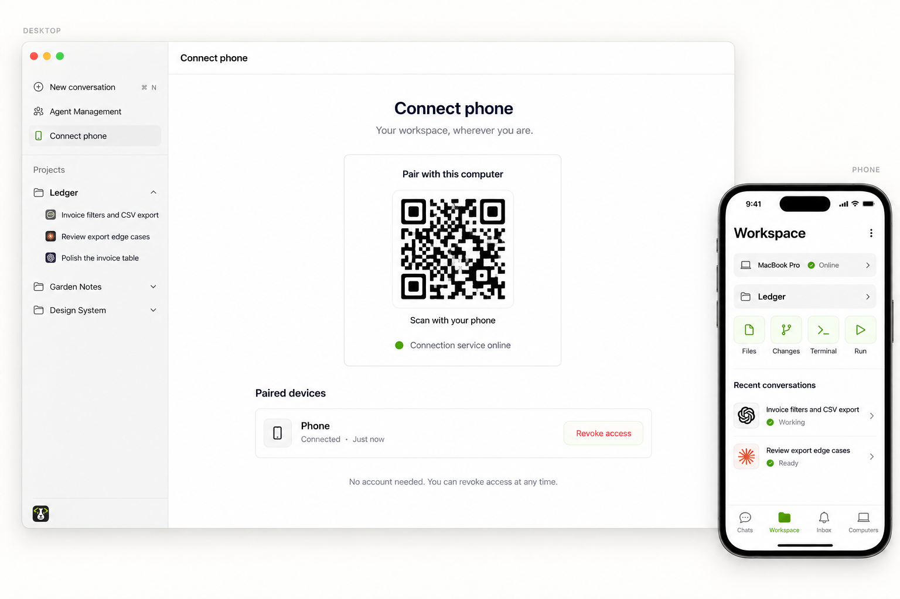
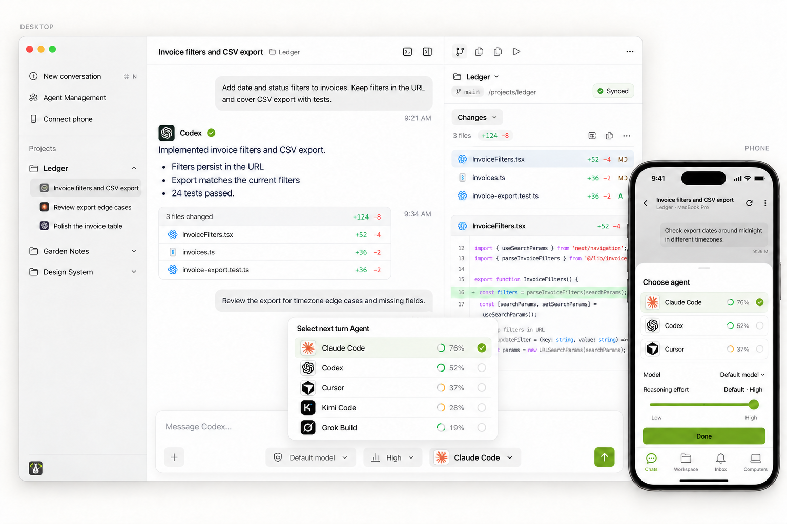
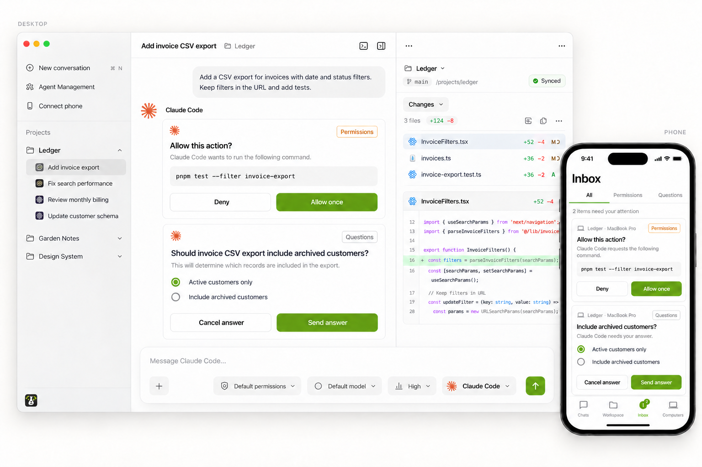
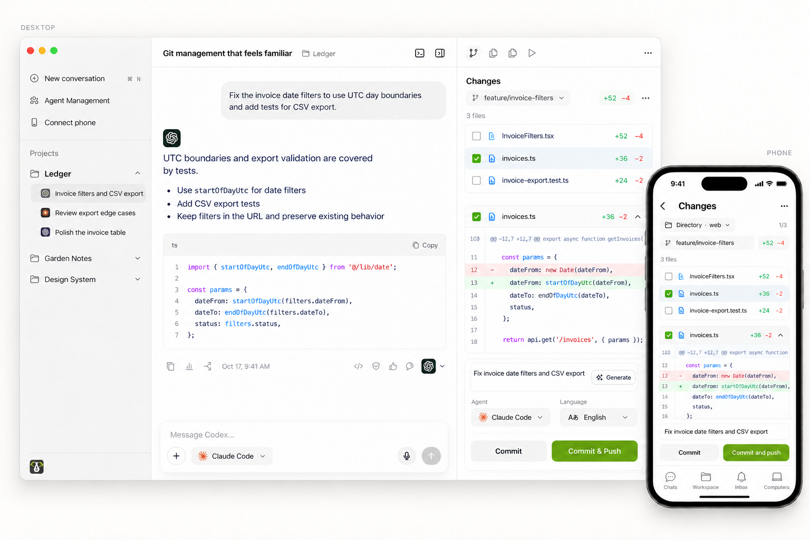
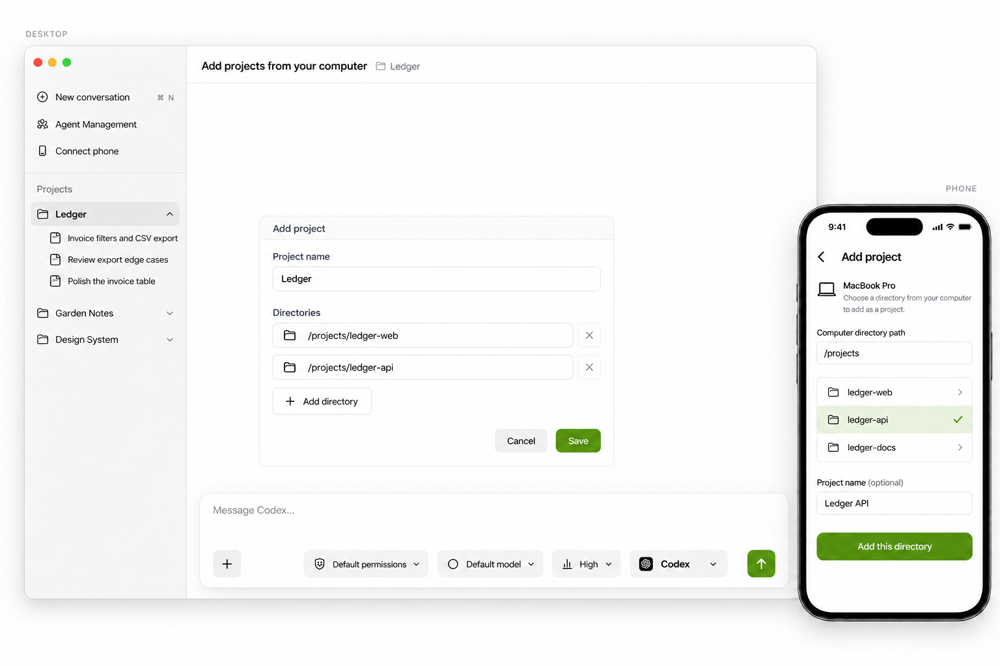
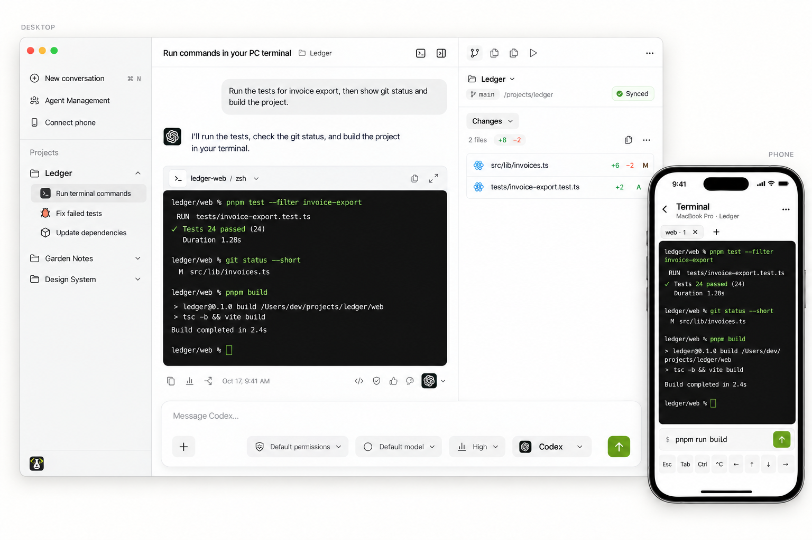
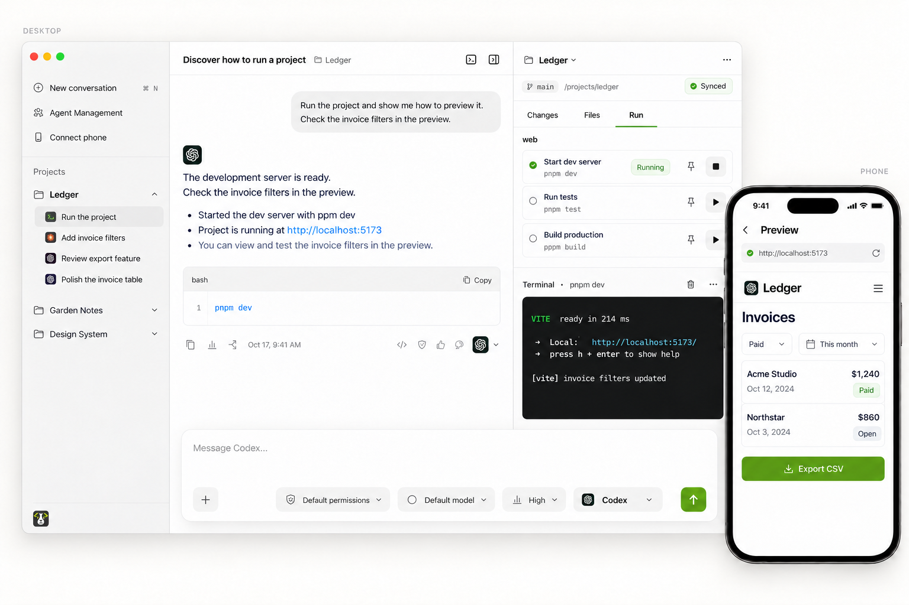
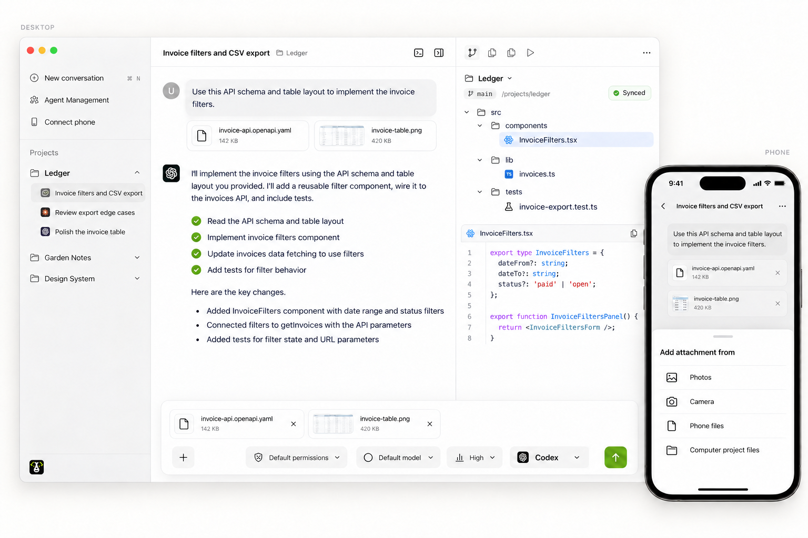
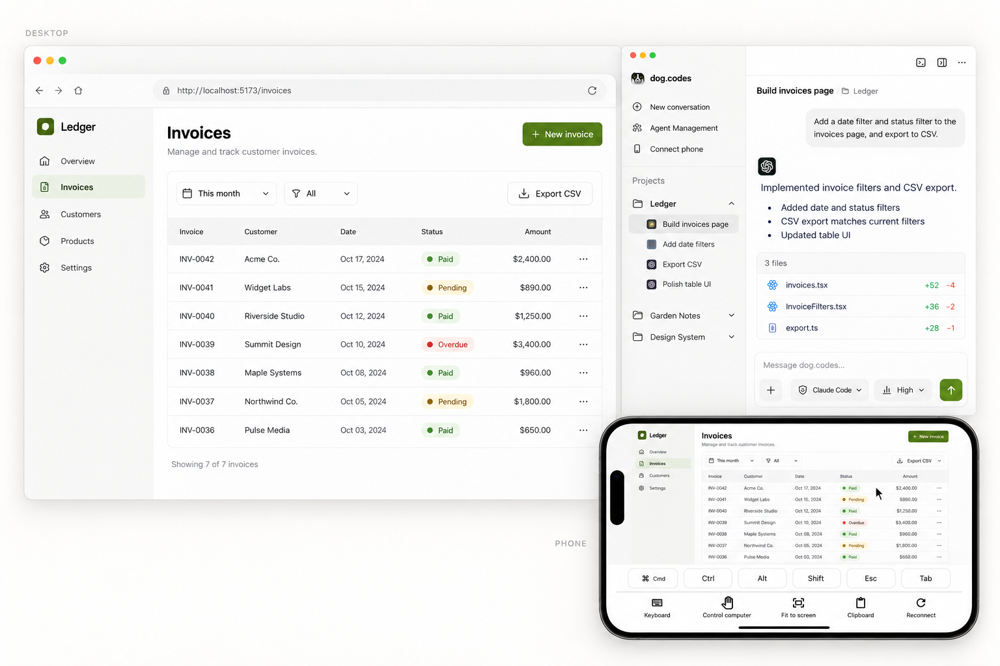

<!-- Keep README languages aligned with the desktop phone-remote section. -->

# dog.codes.mobile

**Pilotez vos agents depuis votre téléphone**

<a href="../../README.md">English</a> · <a href="../../docs/i18n/README.zh-CN.md">简体中文</a> · <a href="../../docs/i18n/README.zh-TW.md">繁體中文</a> · <a href="../../docs/i18n/README.ja.md">日本語</a> · <a href="../../docs/i18n/README.ko.md">한국어</a> · <a href="../../docs/i18n/README.es.md">Español</a> · <strong>Français</strong> · <a href="../../docs/i18n/README.de.md">Deutsch</a> · <a href="../../docs/i18n/README.pt-BR.md">Português (Brasil)</a>

Ce projet est l’app mobile complémentaire pour iOS et Android de l’[app PC dog.codes](https://github.com/owlfy-ai/dogcodes). Son utilisation nécessite l’app PC.

Connectez vos ordinateurs pour reprendre des conversations, approuver des demandes, relire des changements, lancer des projets et utiliser le bureau à distance. Les agents tournent sur votre ordinateur avec vos comptes et abonnements existants.

[dog.codes](https://dog.codes) · [App de bureau](https://github.com/owlfy-ai/dogcodes/blob/main/docs/i18n/README.fr.md) · [Fonctionnalités](#phone) · [Développement](../../docs/development.md)

## Agents pris en charge sur votre ordinateur

Connectez les agents que vous utilisez déjà. Les 12 intégrations ci-dessous sont implémentées ; les modèles, autorisations, données de consommation et fonctions de reprise varient selon l’agent et sa version. Installez chaque agent et connectez-vous avec ses outils officiels.

  
  
  
  
  
  
   
  
  
  
  
  
  

## Pilotez vos agents depuis votre téléphone

**Laissez le portable à la maison. Vos agents continuent de travailler sur votre ordinateur pendant que votre téléphone garde la main.**

Appairez un téléphone une seule fois et faites tout ce qui suit de n’importe où. Votre code et vos agents restent sur votre ordinateur.

- **Reprenez ou démarrez des conversations.** Reprenez n’importe quelle conversation de votre ordinateur ou lancez-en une nouvelle : choisissez l’agent, le modèle et le niveau de raisonnement, suivez la sortie en direct, puis recherchez, épinglez, archivez ou bifurquez des sessions.

  

- **Approuvez et répondez.** Les demandes d’autorisation et les questions des agents arrivent sur votre téléphone avec des notifications push ; un appui et l’agent continue. Chaque approbation est vérifiée par rapport à l’exécution d’origine sur votre ordinateur.

  

- **Relisez et validez.** Consultez les changements de chaque dossier du projet, indexez des fichiers, faites écrire le message de commit par un agent, puis validez, poussez, tirez ou synchronisez. Parcourez l’historique des commits et comparez des branches en lecture seule.

  

- **Ajoutez des projets depuis votre PC.** Parcourez les dossiers de votre ordinateur et ajoutez-en un comme projet sans retourner à votre bureau.

  

- **Exécutez des commandes dans le terminal de votre PC.** Ouvrez des terminaux dans n’importe quel dossier du projet et travaillez dans le vrai shell de votre ordinateur.

  

- **Lancez le projet, voyez-le sur votre téléphone.** Démarrez les entrées de lancement sur votre ordinateur et ouvrez l’app web en cours d’exécution directement sur le téléphone.

  

- **Parcourez les fichiers et envoyez des pièces jointes.** Lisez les fichiers du projet et joignez fichiers et images à vos messages.

  

- **Bureau à distance au besoin.** Affichez l’écran de votre ordinateur et touchez, glissez, faites défiler, pincez, saisissez ou collez du texte et des images, avec une qualité qui s’adapte au réseau.

### Comment ça se connecte

- Un seul scan de QR code, sans compte. La liaison est chiffrée de bout en bout. Appairez plusieurs ordinateurs, voyez lesquels sont en ligne et révoquez un téléphone à tout moment depuis l’app de bureau.
- Le téléphone se connecte directement quand c’est possible, sinon il passe par le service de relais dog.codes, qui ne fait que transmettre du trafic chiffré.
- Votre ordinateur reste allumé avec dog.codes ouvert ou réduit. Tant qu’un travail ou une session à distance est actif, dog.codes peut empêcher la mise en veille automatique ; vous pouvez le désactiver.
- Le bureau à distance fonctionne avec les ordinateurs macOS, Windows et Linux (X11 et Wayland) ; votre système d’exploitation demande les autorisations d’écran et de saisie nécessaires.

## Bien démarrer

1. Configurez l’[app de bureau dog.codes](https://github.com/owlfy-ai/dogcodes/blob/main/docs/i18n/README.fr.md), installez au moins un agent compatible, connectez-vous à son compte et ajoutez vos dossiers de projet.
2. Gardez dog.codes ouvert ou réduit, ouvrez **Connect phone** et scannez le QR code avec **Connect computer** dans l’app mobile.
3. Choisissez un ordinateur et un projet, puis reprenez une conversation ou démarrez-en une nouvelle.

L’interface mobile est disponible en chinois simplifié et en anglais. Pour compiler les sources, appairer en local, tester et consulter les détails d’implémentation, voir le [guide de développement](../../docs/development.md).

Les icônes des agents sont partagées avec l’app de bureau ; voir les [sources et mentions](../../docs/images/readme/agents/README.md). Les noms de produits et marques appartiennent à leurs propriétaires respectifs.
